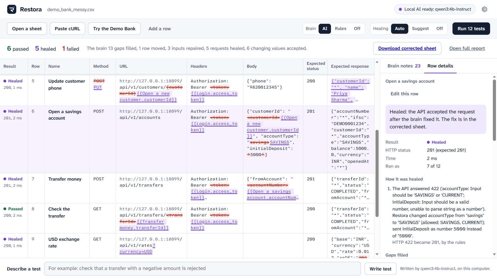
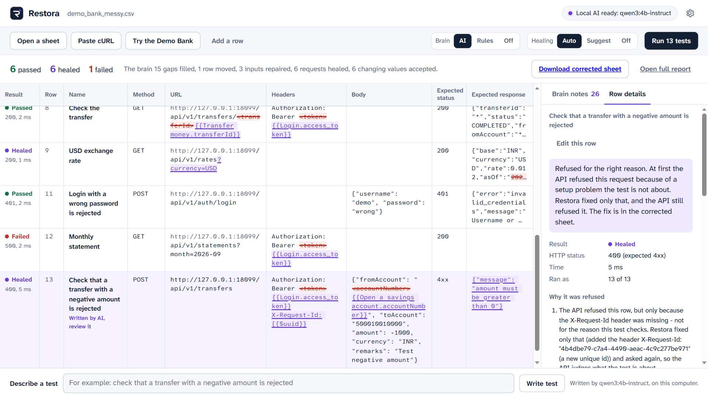
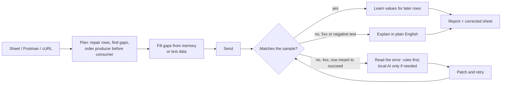

# Restora

**Self-healing API tests from a spreadsheet.** Restora reads your test sheet the way an experienced tester
would. It fills in the values you left blank and puts the steps in a workable order. When the API rejects a
request, Restora reads the error, fixes the request and tries again, then explains in plain English
whatever still fails. Every change shows up as a tracked change you can review. It runs on your own
computer, for free, with an optional open-source AI model.

[](https://github.com/VYADDISURVE07/restora/actions/workflows/ci.yml)




> **[Watch the demo video](https://github.com/VYADDISURVE07/restora/raw/main/docs/media/restora_demo.mp4)** (4 minutes, with sound, recorded on a Windows PC
> with the local model). It shows a tester with an incomplete sheet, a test written from plain English, and a power
> user on the command line. The voice is Kokoro-82M, an open text-to-speech model, and the music was generated for
> the video.

---

## Why it exists

API tests written by people are rarely complete. The login token has to be copied by hand into every later
request. An id only exists after an earlier call creates it. Rows end up in the wrong order. The sample
payload came from a document that no longer matches the API. Most tools need complete, exact input
(Postman, pytest), a formal OpenAPI spec (RESTler, Schemathesis, research tools like AutoRestTest), or a
cloud AI service (Postman Agent Mode, Keploy, Qodex). A bank cannot send test data to a cloud AI.

Restora takes a different route. It accepts the sheet as it is and repairs it, using fast rules first and a
small local model only when the rules have no answer. It shows its working, and it refuses to hide real bugs.

## What the brain does

| You give it | The brain | Example |
|---|---|---|
| Gaps: `<token>`, `{customerId}`, `TBD`, `{{Login.id}}` | Fills them from earlier responses, or with realistic test data (Indian formats: mobile, PAN, IFSC, GSTIN) | `Bearer <token>` becomes the token returned by the Login row |
| Rows in the wrong order | Moves a row up when another row clearly needs a value it returns | "Login" runs before "My accounts" |
| Almost-JSON, blank methods, short URLs | Repairs quotes and commas, picks the method from the row name, completes `/api/...` | `{'name': 'Priya',}` becomes valid JSON |
| A request the API rejects | Reads the error (Spring, FastAPI, Express, Rails, ASP.NET and RFC 7807 styles), patches the request, retries | 415 adds the content type; 405 switches to an allowed method; "phone is required" adds a phone number |
| A sample response copied from documentation | Accepts ids, timestamps and tokens that change on every call, and says so | `"createdAt": "2026-10-20T09:00:00Z"` matches any timestamp |
| A negative test refused for the wrong reason | Fixes only the setup (a missing header or login) and asks again, so the API judges what the test is about | "A transfer with a negative amount is rejected" was refused only because `X-Request-Id` was missing. With the header added, the API still refuses it, now because of the amount |
| A failure | Explains it in one or two plain sentences | "The server failed (HTTP 500)... a bug in the API, not in your sheet" |
| A sentence | Writes test rows from plain English (needs the local AI) | "check that a transfer with a negative amount is rejected" |



At the end of a run you also get a **corrected sheet**. It keeps your rows, puts them in the order that
worked and applies every fix. Gaps are replaced by explicit references (`{{Login.access_token}}`,
`{{$email}}`) and missing sample responses are captured. It runs even with the brain switched off.

### What it never does

- **Never makes a negative test pass.** "Login with a wrong password gives 401" stays a test of rejection. Restora
  only checks that the API refuses it for the reason the test is about: it may add a missing header or the login
  token, never change the body, and a test that is then accepted fails.
- **Never heals a server error (5xx).** That is a bug in the API, so Restora reports it.
- **Never invents credentials.** A login token comes only from an earlier response. API keys, signatures and
  national IDs (Aadhaar) come only from you, and every report masks them.
- **Never hides a fix.** A healed row is marked HEALED, not PASSED. Every change has a reason, and CI can be set to fail on healed rows.
- **Never sends your data anywhere.** The AI runs on your machine (Ollama), and secrets are masked even from it.

## Quick start

You need Python 3.9 or newer. Then, in the Restora folder:

| | Windows | Mac / Linux |
|---|---|---|
| Install (once) | double-click `setup.bat` | `sh setup.sh` |
| Point-and-click app | double-click `studio.bat` | `sh studio.sh` |
| Try the Demo Bank in a terminal | `run.bat --demo` | `sh run.sh --demo` |
| Add the free local AI (optional) | double-click `ai_setup.bat` | `sh ai_setup.sh` |

The Demo Bank is a fictional banking API that ships with Restora, so everything works offline. Its sample
sheet (`examples/demo_bank_messy.csv`) has every problem the brain can fix. The run ends with 6 rows
passed, 5 healed and 1 failed: the failure is a deliberate server bug, which Restora reports instead of
hiding. With the brain off, all 12 rows fail.

No Python on the machine? See [SETUP_GUIDE.md](SETUP_GUIDE.md), which also covers offline installs and company proxies.

## For testers: Studio

`studio.bat` opens a local web page (nothing leaves your computer):

1. **Open a sheet** (CSV or Excel with a URL column), a **Postman collection**, or **paste cURL commands**
   copied from the browser's developer tools. You can also choose **Try the Demo Bank**.
2. Gaps show in amber, and **Brain notes** list what will happen before anything is sent.
3. **Run.** Rows turn Passed, Healed or Failed as they finish. The brain's edits appear on the sheet as tracked changes.
4. **Download the corrected sheet** or **open the full report** (one HTML file you can email).

Type a sentence in **Describe a test** and the local AI writes the row for you to review.

## For engineers: the command line

```text
python run.py my_tests.xlsx                 run a sheet (CSV / Excel)
python run.py collection.json --env env.json   a Postman collection (scripts not needed: the brain chains values)
python run.py commands.txt                  cURL commands, one or many
python run.py --demo                        the Demo Bank example
python run.py my_tests.csv --plan           show what the brain would change; send nothing
python run.py my_tests.csv --brain rules    no AI: fast and exactly repeatable
python run.py my_tests.csv --heal suggest   verify fixes but do not apply them
python run.py my_tests.csv --strict         exact comparison (no automatic acceptance of changing values)
python run.py my_tests.csv --junit out.xml  JUnit XML for CI
python run.py my_tests.csv --ask "transfer with a negative amount is rejected"   write tests with the local AI
python run.py --ai-check                    is the local model installed and answering?
python run.py --selftest                    Restora's own tests
```

Every run writes `reports/<sheet>_<time>/` containing:

- `report.html`, one self-contained page
- `results.csv`
- `<sheet>_corrected.csv` (and `.xlsx` for Excel input)
- `brain.json`, the plan and what the brain did
- `allure-results/`

Exit code: 0 when everything passed or healed, 1 on failures, 2 on input errors.

**Customise everything** in [`restora.toml`](restora.toml): brain mode, heal mode and statuses, the model
and server (Ollama or any OpenAI-compatible server such as LM Studio, llama.cpp or vLLM), fixed test data,
synonyms. **Plug-ins** in `plugins/` can add generators, sign requests, add healing rules or mark more
fields as dynamic. See [plugins/README.md](plugins/README.md) and the
[power-user example](examples/power_user/), which signs requests with an HMAC that no AI could guess.

**In CI** (GitHub Actions, Jenkins ...):

```yaml
- run: pip install -r requirements.txt
- run: python run.py tests/api_tests.csv --brain rules --heal suggest --junit results.xml
```

## How it works



More detail in [docs/HOW_IT_WORKS.md](docs/HOW_IT_WORKS.md). The research behind the design, and how
Restora compares with existing tools, is in [docs/WHY_RESTORA.md](docs/WHY_RESTORA.md).

## The local AI

Restora works without any AI. With [Ollama](https://ollama.com) and a small open model (default
`qwen3:4b-instruct`, which is Qwen3-4B-Instruct-2507, Apache-2.0), the brain also:

- suggests values for fields the rules do not recognise
- reads error messages the rules cannot parse
- explains unusual failures
- writes tests from plain English

Each answer is forced into a JSON schema, so even a small model returns usable output, and checked before
use. The model is asked only when the rules have no answer: on the Demo Bank sheet, every heal is done by
rules. On an RTX 2060 (6 GB) each answer takes about 2.5 to 5 seconds; the model also runs on a CPU, more slowly.
Use an instruct (non-thinking) model: a thinking model such as plain `qwen3:4b` spends seconds reasoning
before every answer, and Restora does not need that.

## Project layout

```text
run.py                  command line          restora/brain/     the brain (planner, memory, heal, errors, AI ...)
restora.toml            settings              restora/studio/    the web app (standard library only, works offline)
examples/               Demo Bank sheets      demo/              the fictional Demo Bank API
plugins/                your plug-ins         selftest/          100+ tests, run with --selftest
```

## Roadmap

- OpenAPI import (use a spec when there is one, for types and required fields)
- Learning across runs (remember which fields change, which fixes worked)
- Multipart / file bodies and GraphQL-aware healing
- A pip package with a `restora` command

## Author

Built by **Vedant Surve**, who automates API and UI testing in banking. Restora grew out of a simpler
spreadsheet-driven tester. The brain was added so that people who are not programmers can rely on it,
without their test data leaving the building.

Licensed under the [MIT License](LICENSE).
